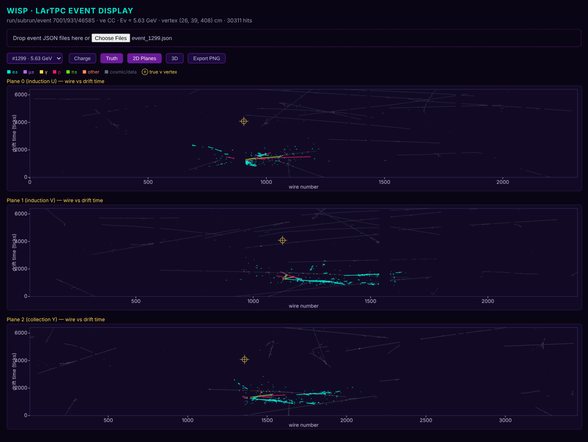
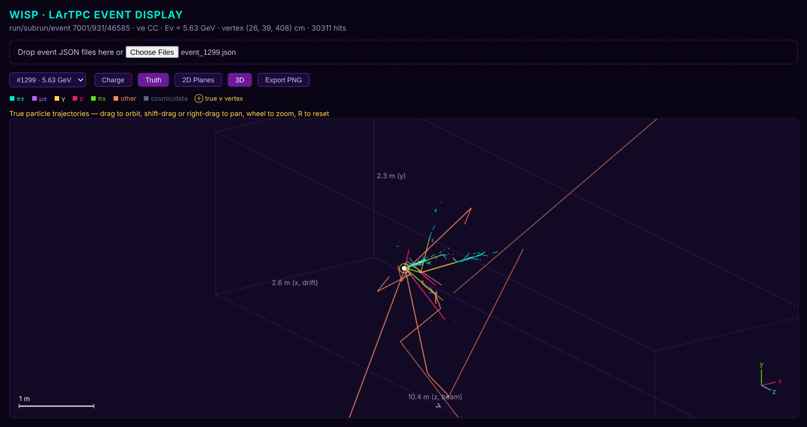

# Wisp

**A browser event display for liquid argon TPC (time projection chamber) neutrino data.** Formerly NuView.

**Write-up:** [Wisp: a neutrino event display in one HTML file](https://devingaughan.com/writing/wisp-neutrino-event-display.html)

Wisp starts with the MicroBooNE public samples. It is part of the Auraeon project family: interactive visualizations of physical systems.

Existing LArTPC event displays are desktop applications tied to the ROOT / LArSoft software stack. Wisp takes the opposite approach: a single HTML file with zero dependencies that runs in any browser, fed by a small Python script that converts open-data HDF5 events to JSON. No framework installs, no experiment credentials. Anyone can inspect real simulated neutrino interactions in under five minutes.

## Features

- **Three wire-plane views** (induction U, induction V, collection Y), wire number against drift time, with labeled axes and ticks
- **Charge mode**: hits colored by deposited charge, clipped at the 97th percentile so one bright hit does not wash out the rest
- **Truth mode**: hits colored by the true particle that produced them (e±, μ±, γ, p, π±, other), with cosmic/data hits dimmed
- **True neutrino vertex** marked with a crosshair on each plane
- **3D view** of true particle trajectories inside the detector outline, with orbit, pan, zoom, an xyz orientation triad, and a dynamic scale bar
- **Multi-event browsing**: drop several event files and switch between them
- **PNG export** of the current view

## Quick start

Five sample events are included in this repository, so you can try Wisp without downloading any data:

1. Clone or download this repository.
2. Open `index.html` in a browser.
3. Drop one or more of the `event_*.json` files onto the page.

### Extracting your own events

1. Download a MicroBooNE open-sample HDF5 file (the NoWire variant is sufficient):
   https://doi.org/10.5281/zenodo.7261921
2. Install the two Python dependencies: `pip install h5py numpy`
3. Extract an event:
   `python extract_event.py nue_NoWire_18.h5 1299 event_1299.json`
4. Drop the resulting JSON onto `index.html`.

## Controls

| Action | Input |
|--------|-------|
| Switch coloring | **Charge** / **Truth** buttons |
| Switch view | **2D Planes** / **3D** buttons |
| Orbit (3D) | Drag |
| Pan (3D) | Shift-drag or right-drag |
| Zoom (3D) | Mouse wheel |
| Reset 3D camera | `R` |
| Save an image | **Export PNG** |

## How it works

`extract_event.py` reads one event from the HDF5 file and writes a compact JSON document with three parts: event metadata (neutrino flavor, energy, vertex), the hits on each wire plane, and the true particles. Each hit is matched to the particle that deposited the most energy in it, using the `edep_table` join.

`index.html` draws everything on plain 2D canvases. The 3D view is a hand-written orthographic projection, so there is no WebGL and no library to load.

## Roadmap

- Reco mode: color by Pandora PFP / slice
- Event browser across a whole file

## About the name

A will-o'-the-wisp is a faint light that drifts through the dark and is nearly impossible to catch. Neutrinos pass through matter almost without a trace, and what a detector records of them is a thin trail of light and charge.

## Acknowledgment

We acknowledge the MicroBooNE Collaboration for making publicly available the data sets employed in this work: DOI 10.5281/zenodo.7261921 (CC-BY 4.0). See https://github.com/uboone/OpenSamples for official documentation.

Wisp is an independent project and is not affiliated with or endorsed by the MicroBooNE Collaboration.

## License

Code: [MIT](LICENSE). The bundled sample events are derived from the MicroBooNE public data sets and remain under CC-BY 4.0.
